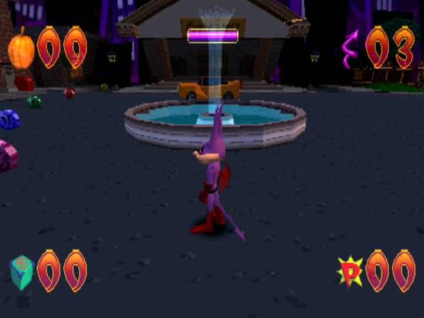
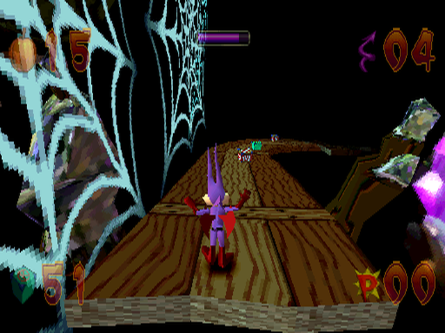
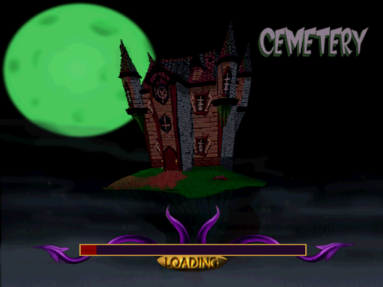

# Jersey Devil Recompiled

**[Read more about it](https://1379.tech/getting-into-the-halloween-spirit-with-recompilations/)** on the blog.

Play the PlayStation 1 game **Jersey Devil** as a real PC game.

<p align="center">
  
</p>

## What is this?

Jersey Devil came out on the PlayStation in 1998. Normally, to play it on a PC,
you use an emulator. An emulator copies the old console step by step while you
play, so your PC is doing two jobs at once.

This project does something different. It **translates the game one time** into
a program your PC understands. After that, your PC just runs the game. There is
no console being copied in the background.

That means:

- It runs smoothly on normal PCs.
- It is a real `.exe` you open like any other game.
- You can add extra features later, like widescreen.

**This project does not include the game.** You need your own copy of the
Jersey Devil disc. See below.

<p align="center">
  
  
</p>

## How do I play it?

**You need two things:**

1. This program.
2. A copy of the **Jersey Devil (USA)** disc that you own, saved on your PC as
   a `BIN/CUE` file.

### Step 1 — Get the program

Go to the [Releases page](https://github.com/mstan/JerseyDevilRecomp/releases/latest)
and download the Windows ZIP. Unzip it somewhere, then open the `.exe` inside.

> Nothing is on the Releases page yet. This project is brand new. For now you
> can build it yourself — see [For developers](#for-developers).

### Step 2 — Point it at your disc

The first time you open it, a small setup window appears. It asks you to find
your disc file. Choose the `.cue` file.

Keep **all 45 track files** in the same folder as the `.cue` file. Jersey Devil
plays its music from those tracks. If they are missing, the game still runs but
the music will not play.

Then press **Generate & Build**. This is the translation step. It takes a few
minutes and only happens once. After that, press play.

### About the disc

You have to bring your own disc file. We do not include it, and we cannot help
you find one. This is the same rule every project like this follows: the game
belongs to its owners, so only you can supply your own copy.

You do **not** need a PlayStation BIOS file. A free open one called OpenBIOS is
already included.

### Controls

The game uses the D-pad, not the analog sticks. A USB controller works. You can
also use the keyboard — arrow keys to move, `X` to jump. You can change any key
in the launcher.

## What works right now?

The Mods page offers widescreen: Adaptive (fits your window) or a fixed 16:9.
Higher internal resolution is in the launcher's video settings.

Frame interpolation from earlier previews has been withdrawn because it garbled
the picture. It can no longer be enabled, including from older saved settings.

The game boots, plays its intro, loads levels, and you can run around and play.
That is as far as testing has gone. Version **0.3.2** remains a preview build.

Expect rough edges. If something looks wrong or freezes, that is useful to know —
please tell us (see below).

## How can I help?

You do not need to be a programmer to help.

**Report a bug.** Open an [issue](https://github.com/mstan/JerseyDevilRecomp/issues)
and tell us:

- what you were doing,
- what happened,
- what you expected instead.

A screenshot or a short video helps a lot. Saying which level you were in helps
even more.

**Tell us what works.** "I finished this level with no problems" is genuinely
useful. It tells us which parts are safe and which parts still need attention.

**Do not post disc files or BIOS files** in issues, and do not ask where to get
them. Those posts get removed.

**If you do write code:** open a pull request. Small, focused changes are easier
to review than large ones. Most of the interesting work lives in the shared
framework, [psxrecomp](https://github.com/mstan/psxrecomp), not in this
repository.

## For developers

This repo holds the settings and the small amount of glue code for Jersey Devil.
The actual engine is the [psxrecomp](https://github.com/mstan/psxrecomp)
framework and the [recomp-ui](https://github.com/mstan/recomp-ui) launcher, both
pinned here as submodules.

```sh
git submodule update --init --recursive
python psxrecomp/psxrecomp_cli.py generate --config game.toml --project-root . --disc "iso/Jersey Devil (USA).cue"
python psxrecomp/psxrecomp_cli.py rebuild  --config game.toml --project-root . --build-dir build-release --no-pgo
```

The result is `build-release/JerseyDevil_Recompiled.exe`. The launcher can run
the same two steps for you. Full setup notes are in the
[framework guide](psxrecomp/docs/GAME_PROJECT_SETUP.md).

Game details: USA release, serial **SCUS-94907**, boot executable
`SCUS_949.07`, 45 disc tracks, single player.

Widescreen guards cover the horizontal clip and subdivision bounds in all
five renderer bank variants, including Credits. The original vertical bounds
remain unchanged. With local static overlay captures, check the original
clip instructions using:

```sh
python tests/check_renderer_bounds.py --captures generated/static_exe_captures.json
```

To check other decoded banks, pass their local PS-X EXE wrappers with repeated
`--image <path>` arguments. The check covers 4:3, 16:9, 21:9 and 32:9; it does
not replace gameplay checks across every level and camera.

### What is in this repo

| Folder | What it holds |
| --- | --- |
| `game.toml` | Disc details and game settings |
| `seeds/` | Starting points the translator uses to find code |
| `symbols.toml` | Human-readable names for game functions |
| `psxrecomp/`, `recomp-ui/` | The shared framework and launcher |
| `iso/`, `disc/`, `generated/` | Made on your PC, never uploaded here |

## License

PolyForm Noncommercial 1.0.0. See `LICENSE`.

No game data is stored in this repository. No disc files, no PlayStation BIOS,
and no translated game code — all of that is made on your own PC from your own
disc, and Git is set to ignore it.

OpenBIOS is included under its MIT license. Box art shown in the launcher comes
from libretro-thumbnails; the source is recorded in
[BOXART_SOURCE.txt](launcher_assets/img/BOXART_SOURCE.txt).

Jersey Devil and all its characters and artwork belong to their respective
owners. This project is not affiliated with them.

<!-- retcomm-readme-raid -->
---

<p align="center">
  <sub><b>R.A.I.D. - Retro AI Development</b> / a Discord for AI-assisted retro reverse-engineering, decomp &amp; recomp</sub>
</p>

<p align="center">
  <a href="https://discord.gg/Ad9BwSzctP"></a>
</p>
<!-- /retcomm-readme-raid -->

Original-disc overlay preparation and release requirements are documented in [AOT overlays](docs/AOT_OVERLAYS.md).

## v0.3.0 rendering update

Game-code interpolation for higher presentation rates (since withdrawn); camera/model motion stays separate from simulation. Widescreen subdivision and renderer-bank culling fixes retain geometry across the wider view.
